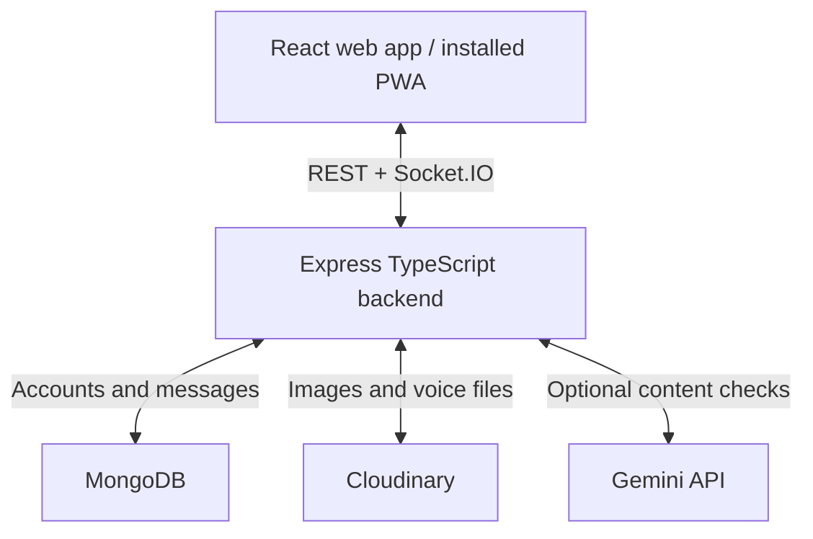

# TalkBridge

### Real-time conversations. Text, images and voice. Web and mobile.

TalkBridge is a full-stack, one-to-one chat application built with React and a TypeScript Express backend. It combines real-time messaging, media sharing, delivery and read receipts, account moderation, and an installable Progressive Web App (PWA) in a responsive interface.

**Developed by Asad Ali · Full Stack Developer**

## Contents

- [Features](#features)
- [Technology stack](#technology-stack)
- [How the application works](#how-the-application-works)
- [Project structure](#project-structure)
- [Getting started](#getting-started)
- [Environment configuration](#environment-configuration)
- [Using TalkBridge](#using-talkbridge)
- [Moderation and account restrictions](#moderation-and-account-restrictions)
- [API reference](#api-reference)
- [Real-time events](#real-time-events)
- [Data models](#data-models)
- [Mobile installation](#mobile-installation)
- [Production deployment](#production-deployment)
- [Scripts and verification](#scripts-and-verification)
- [Troubleshooting](#troubleshooting)
- [Security and privacy](#security-and-privacy)
- [Current scope](#current-scope)

## Features

### Accounts and personalization

- Sign up, sign in, sign out, and restore authenticated sessions.
- Password hashing with bcrypt and JWT authentication through an HTTP-only cookie.
- Edit your display name and upload a profile photo.
- View account status and membership date.
- Select a theme with a live chat preview; the preference is saved locally.

### Messaging

- Real-time, one-to-one text conversations using Socket.IO.
- Image selection, preview, and sharing.
- Microphone recording with preview, playback, send, and discard controls.
- Emoji selection, typing indicators, online status, and last-seen information.
- Reply to messages in the same conversation and navigate to the quoted message.
- Delete your own messages for everyone, with a `Message deleted` placeholder.
- Preserve drafts and attachments after failed sends so users can retry.
- Synchronize messages and account changes across connected tabs or devices.

### Conversation experience

- Per-conversation unread badges and a total unread badge on the mobile menu.
- Initial scrolling to the first unread message.
- A jump-to-latest control when viewing older messages.
- Stable scrolling when new messages arrive while reading earlier messages.
- Sent, delivered, and read indicators in messages and conversation previews.
- Contact ordering by recent activity and an online-only filter.
- Notification audio after the browser allows playback following user interaction.

### Moderation and mobile support

- Local profanity checks with optional Gemini checks for text, images, and spoken audio.
- Immediate 24-hour messaging restriction on the first detected violation.
- A site-wide restriction notice, expiry countdown, and server-side enforcement.
- Continued sending with a warning and local checks when Gemini returns HTTP 429.
- Responsive desktop/mobile layout and a top-navbar **Install App** button.
- Standalone PWA launch, home-screen icons, and a public offline fallback page.

## Technology stack

| Layer | Technologies |
| --- | --- |
| Frontend | React 19, TypeScript, Vite, React Router |
| Interface | Tailwind CSS 4, DaisyUI 5, Lucide icons |
| State and HTTP | Zustand, Axios, React Hot Toast |
| Backend | Node.js, Express 5, TypeScript |
| Database | MongoDB, Mongoose |
| Real-time communication | Socket.IO |
| Authentication | JSON Web Tokens, bcryptjs, HTTP-only cookies |
| Media storage | Cloudinary |
| Optional AI moderation | Gemini REST API through native Node.js HTTPS |
| PWA | Web app manifest, service worker, browser installation APIs |
| Backend verification | Node.js test runner, mongodb-memory-server, mocked external services |

Package manifests and lockfiles contain the exact dependency versions used by the project.

## How the application works

### Architecture



The browser never receives database, Cloudinary secret, or Gemini credentials. It sends authenticated requests to the backend, which handles validation, moderation, persistence, and real-time updates.

### Message lifecycle

1. The sender submits text, an image, or a voice recording, optionally referencing a message being replied to.
2. The backend authenticates the sender, validates the recipient and payload, checks the account restriction, and validates any reply reference.
3. Local moderation runs first. If configured and available, Gemini evaluates the submitted content before upload or delivery.
4. Allowed media is uploaded to Cloudinary. The message and its media URL are saved in MongoDB.
5. Socket.IO publishes the saved message to the sender's and recipient's authenticated user rooms. The frontend merges HTTP and socket results by message ID to avoid duplicate bubbles.
6. The recipient's browser acknowledges delivery. Visible incoming messages in an active, focused conversation are marked read, updating receipts and unread counters.

Failed sends retain the draft. History requests are guarded against conversation switches so an older response does not overwrite the newly selected chat. Reconnecting refreshes account/contact/history state; undelivered messages are sent to the recipient for acknowledgement.

### Message ticks

| Indicator | Meaning |
| --- | --- |
| Single grey tick | The backend accepted and saved the message. |
| Double grey ticks | A recipient client acknowledged receipt. |
| Double blue ticks | The recipient client marked the message read in the visible conversation. |

Opening a chat positions the viewport at its first unread message. Messages are marked read through the latest visible incoming message; simply having a conversation selected behind the mobile drawer does not mark its messages read.

### Replies and deletion

A reply must reference an existing, non-deleted message belonging to the same two users. Only the sender can delete a message. Deletion clears its content, updates both clients and quoted views, and retains a placeholder in history. For tracked uploads, the backend also attempts Cloudinary cleanup. Older media without stored Cloudinary identifiers cannot be cleaned up automatically.

## Project structure

| Path | Purpose |
| --- | --- |
| `backend/src/index.ts` | Express setup, routes, startup, and error handling |
| `backend/src/controllers/` | Authentication and messaging request handlers |
| `backend/src/routes/` | REST endpoint definitions |
| `backend/src/models/` | User and Message schemas |
| `backend/src/middleware/` | Authenticated-route protection |
| `backend/src/services/` | Moderation, Gemini transport, and media validation/uploads |
| `backend/src/libs/` | Database, Cloudinary, cookie/JWT configuration, and Socket.IO |
| `backend/src/seeds/` | Optional development sample users |
| `backend/tests/` | Backend integration and moderation tests |
| `frontend/src/pages/` | Chat, authentication, profile, and settings pages |
| `frontend/src/components/` | Chat UI, installation controls, and restriction notice |
| `frontend/src/store/` | Authentication, messaging, and theme state |
| `frontend/src/lib/` | API client and frontend helpers |
| `frontend/public/` | Manifest, icons, service worker, sounds, and offline page |
| `TEST_RESULTS.md` | Validation performed and remaining deployment checks |

Keep `backend` and `frontend` as sibling directories when using the backend to serve the production frontend.

## Getting started

### Requirements

- Node.js **22.12 or newer** and npm.
- A running local MongoDB instance or a MongoDB Atlas connection string.
- Cloudinary credentials for image, voice, and profile-photo uploads.
- An optional Gemini API key and a model accessible to its project for AI moderation.

There is no root npm package. Run commands inside `backend` or `frontend` as shown below.

### 1. Install and configure the backend

```bash
cd backend
npm ci
cp .env.example .env
```

For Windows PowerShell, replace the copy command with:

```powershell
Copy-Item .env.example .env
```

Edit `backend/.env`. Set `MONGODB_URI`, a strong `JWT_SECRET`, and your Cloudinary settings. Keep development cookie settings for localhost. If upgrading an existing installation, **preserve your working `.env`** instead of copying over it.

```bash
npm run dev
```

The backend connects to MongoDB before accepting requests. Its default address is `http://localhost:5000`; `GET /api/health` returns `{"status":"ok"}`.

### 2. Start the frontend

Open another terminal from the project root:

```bash
cd frontend
npm ci
npm run dev
```

Open **http://localhost:5173**. The Vite development proxy forwards `/api` and `/socket.io` to port 5000. If that port changes, update `frontend/vite.config.ts` as well.

### 3. Try a conversation

Create two accounts in separate browser profiles or normal/incognito sessions. Select the other user from the sidebar and send a message. Separate sessions are needed because tabs in the same browser profile share the authentication cookie.

## Environment configuration

### Backend: `backend/.env`

| Variable | Purpose / local value |
| --- | --- |
| `PORT` | HTTP and Socket.IO port; defaults to `5000`. |
| `MONGODB_URI` | Database URI, for example `mongodb://127.0.0.1:27017/chatapp`. |
| `JWT_SECRET` | Required, private signing secret; use a long random value. |
| `CLIENT_URL` | Comma-separated allowed frontend origins, including the scheme and port. The example allows `http://localhost:5173,http://localhost:5174`. |
| `NODE_ENV` | Use `development` locally and `production` on the deployed server. |
| `COOKIE_SAME_SITE` | `lax` locally or for a same-origin deployment; `none` for a cross-site HTTPS setup. |
| `SERVE_FRONTEND` | Set `true` to serve the sibling `frontend/dist` build; otherwise use `false`. |
| `CLOUDINARY_CLOUD_NAME` | Your Cloudinary cloud name. |
| `CLOUDINARY_API_KEY` | Your server-side Cloudinary API key. |
| `CLOUDINARY_API_SECRET` | Your server-side Cloudinary API secret. |
| `GEMINI_API_KEY` | Optional; leave empty for local text filtering only. |
| `GEMINI_MODEL` | Explicitly set a Gemini model accessible to your API-key project. |

The shipped example and code fallback use `gemini-2.5-flash`. That value is not a guarantee of availability for your account. Keep your currently working model, or select an accessible model before enabling Gemini. Changing the API key does not change the configured model. Restart the backend after editing its environment.

### Frontend: `frontend/.env` or `.env.production`

| Variable | Same-origin / development value | Separate backend example |
| --- | --- | --- |
| `VITE_API_BASE_URL` | `/api` | `https://api.example.com/api` |
| `VITE_SOCKET_BASE_URL` | Leave empty | `https://api.example.com` |

Frontend variables are embedded in the public build. Never put private keys in `VITE_` variables. Rebuild the frontend after changing its production variables.

## Using TalkBridge

1. **Choose a contact:** open the sidebar or mobile menu, optionally filter to online users, and select a conversation.
2. **Send text or an image:** type a message or select a supported image, review the preview, and send.
3. **Send voice:** allow microphone access, record, stop, preview, then send or discard the clip.
4. **Reply:** use a message's Reply action. The reply preview identifies the referenced sender and message.
5. **Delete:** use Delete on your own message and confirm. Both users see the deleted-message placeholder.
6. **Review unread messages:** use the sidebar count or jump-to-latest control; receipts update as messages are read.
7. **Personalize:** edit your name/photo in Profile and choose a theme in Settings.
8. **Install:** use Install App in the top navbar on your deployed HTTPS website.

### Payload limits

| Content | Limit / accepted formats |
| --- | --- |
| Message text | Up to 5,000 characters |
| Message attachments | One image or one audio attachment; optional accompanying text |
| Attachment size | Up to 10 MB of decoded media per attachment |
| Images | JPEG, PNG, WebP, GIF |
| Server audio formats | WebM, Ogg, MP4, MPEG, WAV |
| Voice duration | Up to 120 seconds; recording MIME type depends on the browser |
| Receipt batches | Up to 200 message IDs per request |

A message must contain text or an attachment. The server accepts media as base64 data URLs for message sending. Profile photos use multipart upload. The JSON body limit is 15 MB to accommodate encoded attachments.

## Moderation and account restrictions

### First detected violation: immediate 24-hour block

When local or AI moderation detects prohibited content:

- The offending message is rejected before it is stored or its attachment is uploaded.
- The backend stores `bannedUntil` in MongoDB and increments `moderationStrikes` as a violation count.
- All outgoing text, image, voice, and reply messages to every recipient are blocked for 24 hours.
- Connected tabs receive the restriction immediately. The site displays a countdown, disables send controls, and shows Blocked in Profile.
- The user can still log in and read conversations. Refreshing or signing in again does not remove the restriction.
- After expiry, messaging resumes automatically. Attempts while already blocked do not extend the restriction.

There is no three-strike grace period. Requests from the same account are serialized within the backend process so a later queued send observes a completed ban. The local word list is in `backend/src/services/moderation.service.ts`; the ban duration is applied in `backend/src/controllers/message.controller.ts`.

### Moderation modes and failures

| Situation | Application behavior |
| --- | --- |
| No Gemini key | Local text filter only. Common configured English/Roman Urdu/Urdu terms and some simple substitutions are checked. |
| Gemini enabled and available | Local checks run first; Gemini then evaluates the submitted text/image/audio content. |
| Gemini HTTP 429 | The message can send after local checks, with a warning that AI moderation is limited. AI calls pause for 60 seconds across the current backend process, then the next send tries again. |
| Gemini network/TLS error, timeout, HTTP 403/404, or invalid response | The backend returns HTTP 503; the message is not sent and the draft remains available for retry. |
| Account already restricted | The backend returns HTTP 403 with `code: "BANNED"` and the expiry time. |

The 60-second pause is an application cooldown, not a reset or bypass of Google's quota. Local filtering remains active during it. Images and spoken audio are not AI-checked when Gemini is disabled or paused. Provider failures do not create a violation or account ban.

Gemini requests use fresh IPv4 HTTPS connections with normal certificate verification, a 12-second request deadline, and one retry for transient connection resets/broken pipes. Moderation is synchronous, so its latency is part of the send time. Same-account sends wait their turn.

## API reference

Base prefix: `/api`. Authentication uses the `jwt` cookie; custom clients should preserve cookies and send credentials. Except for signup, login, logout, and health, the endpoints below require an authenticated user.

| Method | Endpoint | Purpose |
| --- | --- | --- |
| `GET` | `/health` | Basic application health response |
| `POST` | `/auth/signup` | Create an account and session |
| `POST` | `/auth/login` | Authenticate and set the session cookie |
| `POST` | `/auth/logout` | Clear the session cookie |
| `GET` | `/auth/check` | Return the current public account data |
| `PUT` | `/auth/update-profile` | Update `fullName` and/or multipart file field `image` |
| `GET` | `/messages/users` | List other users, unread counts, and latest messages |
| `GET` | `/messages/:id` | Load the conversation with user `id` |
| `POST` | `/messages/send/:id` | Send a message to recipient user `id` |
| `PUT` | `/messages/delivered` | Acknowledge received message IDs |
| `PUT` | `/messages/seen/:id` | Mark incoming messages from user `id` as read |
| `DELETE` | `/messages/:id` | Delete an owned message by message `id` |

### Example request bodies

Signup:

```json
{
  "fullName": "Asad Ali",
  "email": "asad@example.com",
  "password": "replace-with-a-strong-password"
}
```

Send text or a reply (`replyTo` is optional and must belong to this conversation):

```json
{
  "text": "Hello! How are you?",
  "replyTo": null
}
```

For an attachment, include `image: "data:image/png;base64,..."` or `audio: "data:audio/webm;base64,..."`. Audio may include `audioDuration` in seconds. Supply only one attachment type per message.

Delivery/read acknowledgement:

```json
{
  "messageIds": ["507f1f77bcf86cd799439011"]
}
```

Successful sends return HTTP **201** with the saved message. During quota fallback the response also includes `moderationWarning`; this warning is displayed to the sender and is not saved as message content. Read requests without `messageIds` retain legacy mark-all support; current clients send scoped IDs.

Errors normally return `{"message":"..."}`. Restriction responses additionally include `code` and `bannedUntil`. Common statuses are 400 for invalid input, 401 for authentication, 403 for a restriction/disallowed origin, 404 for missing resources, 409 for duplicate signup, 413 for oversized payloads, and 503 for unavailable moderation or unconfigured media uploads.

## Real-time events

Sockets authenticate using the session cookie. The backend derives the user identity and joins `user:<id>` rooms; the browser does not choose its authenticated sender ID.

| Event | Direction | Purpose |
| --- | --- | --- |
| `getOnlineUsers` | Server → client | Current connected user IDs |
| `userStatusChange` | Server → client | Online/offline and last-seen updates |
| `typing`, `stopTyping` | Client ↔ server | Typing state for a recipient; sender identity is server-derived |
| `newMessage` | Server → client | Saved message for both users' connected sessions |
| `pendingMessages` | Server → client | Undelivered backlog on recipient connection |
| `conversationUpdated` | Server → client | Latest-message preview changes |
| `messagesDelivered` | Server → client | Delivery receipt updates |
| `messagesSeen` | Server → client | Read receipt updates for the sender |
| `conversationSeen` | Server → client | Read IDs and remaining unread count for recipient sessions |
| `messageDeleted` | Server → client | Deletion and affected unread-count update |
| `moderationUpdated` | Server → client | Account restriction and expiry update |

Send, delete, and receipt writes use REST endpoints; socket events distribute the resulting state changes.

## Data models

| Model | Main fields |
| --- | --- |
| User | `fullName`, unique normalized `email`, hashed `password`, `profilePicture`, `isOnline`, `lastSeen`, `moderationStrikes`, `bannedUntil`, timestamps |
| Message | `senderId`, `receiverId`, `text`, `image`, `audio`, `audioDuration`, `replyTo`, `isDelivered`, `isRead`, `isDeleted`, timestamps |

Message records also retain hidden media identifiers and resource types for Cloudinary cleanup. Images/audio live in Cloudinary; MongoDB stores their URLs and metadata. Reply references link to other messages. Authentication responses exclude the password hash.

## Mobile installation

Deploy the site over **HTTPS** for phone installation and microphone access. A phone opening a plain HTTP address on your computer's local network does not provide the required secure context.

- **Android / supporting browsers:** tap Install App, then approve the native browser prompt when available. If unavailable, the button explains the browser-menu install option.
- **iPhone / iPad:** tap Install App for guidance, then open Safari → Share → Add to Home Screen → Add.
- **Desktop:** supporting browsers can also install the app through the same button or their installation menu.

The installed PWA launches in standalone mode with a home-screen icon. The button hides after confirmed installation or in standalone mode; dismissing instructions keeps it available. Installation is controlled by the browser and requires user approval.

The production service worker caches only a public offline fallback. It does not cache private conversations, API responses, or uploaded media. Messaging requires an internet connection, and closed-app push notifications are not implemented. This project delivers a PWA rather than an APK or app-store package.

## Production deployment

### Option A: frontend and backend on one HTTPS origin

This keeps authentication and socket configuration straightforward.

1. Keep the two project folders as siblings on the server.
2. Run `npm ci` and `npm run build` inside `frontend`.
3. Run `npm ci` and `npm run build` inside `backend`.
4. Configure the backend environment:

```dotenv
NODE_ENV=production
CLIENT_URL=https://chat.example.com
COOKIE_SAME_SITE=lax
SERVE_FRONTEND=true
```

5. Keep frontend `VITE_API_BASE_URL=/api` and leave `VITE_SOCKET_BASE_URL` empty before building.
6. Run `npm start` inside `backend` using your hosting provider's process manager.
7. Configure HTTPS/reverse proxying for HTTP and Socket.IO, including WebSocket upgrades. The backend serves the sibling `frontend/dist` and SPA routes.

Retain the other required backend variables, including database and media credentials. MongoDB and Cloudinary storage must persist independently of the Node process.

### Option B: separate frontend and backend hosts

Set frontend production variables **before building**:

```dotenv
VITE_API_BASE_URL=https://api.example.com/api
VITE_SOCKET_BASE_URL=https://api.example.com
```

Configure the backend with the exact frontend origin in `CLIENT_URL`, `SERVE_FRONTEND=false`, and `NODE_ENV=production`. Cross-site cookie setups require `COOKIE_SAME_SITE=none` and HTTPS; browser third-party-cookie restrictions can still prevent sessions. Prefer a same-origin setup where possible.

The static host must serve application routes through `index.html` while serving manifest, service worker, icons, assets, and offline files directly. `frontend/vercel.json` contains application-route rewrites and service-worker cache headers for Vercel. Deploy the backend to a Node host that supports persistent Socket.IO connections.

## Scripts and verification

### Backend

Run from `backend`:

| Command | Purpose |
| --- | --- |
| `npm ci` | Install dependencies from the lockfile |
| `npm run dev` | Run TypeScript in watch mode |
| `npm run build` | Compile TypeScript into `dist` |
| `npm start` | Run the compiled backend |
| `npm test` | Run backend integration and moderation regression tests |
| `npm run seed` | Insert sample users into the configured database for development |

The optional seed uses sample credentials and inserts users without clearing existing records. Run it only against a development database; repeated runs can encounter duplicate emails. Creating two accounts through the UI is sufficient for ordinary testing.

### Frontend

Run from `frontend`:

| Command | Purpose |
| --- | --- |
| `npm ci` | Install dependencies from the lockfile |
| `npm run dev` | Start Vite with the API/socket proxy |
| `npm run lint` | Run ESLint |
| `npm run build` | Check TypeScript and generate `dist` |
| `npm run preview` | Preview the build; it does not replace the backend |

The validated delivery passed backend compilation, frontend lint/build, and **15 backend tests**. Browser checks covered messaging, reply/delete behavior, media flows, unread/ticks, restriction persistence/expiry, mobile layouts, installation UI, and offline fallback.

Backend tests use an isolated temporary MongoDB and mocked external services. A first test run may download a MongoDB test binary. Browser installation events were simulated and microphone checks used a fake recording source. Verify actual Cloudinary uploads, Gemini project access, device microphone compatibility, and native installation on your final HTTPS deployment. See [TEST_RESULTS.md](TEST_RESULTS.md) for scope and evidence.

## Troubleshooting

| Symptom | What to check |
| --- | --- |
| Backend does not start | Required `JWT_SECRET`, MongoDB URI/connectivity, and available `PORT`. Run from the backend directory. |
| Login succeeds but the session disappears | Allowed frontend origin, credentialed requests, HTTPS, cookie SameSite settings, and browser cookie restrictions. |
| Messages do not update in real time | Socket URL, session cookie, allowed socket origin, persistent backend availability, and proxy WebSocket support. |
| Gemini HTTP 404 | The configured model ID, API endpoint/version, and access for the project owning the key. Changing keys alone does not select another model. |
| Gemini HTTP 403 | Project/key authorization and restrictions. Keep the key private. |
| Gemini HTTP 429 | Project quota/rate limits. The implemented local-filter fallback sends eligible messages with a warning and pauses AI checks for 60 seconds. |
| `ECONNRESET` / moderation unavailable | Backend internet access to `generativelanguage.googleapis.com:443`, firewall, VPN/proxy, or Wi-Fi routing. A root URL HTTP 404 shows reachability only; it does not validate the model/key. |
| Sending takes several seconds | Gemini moderation runs before persistence; media uploads add time. Same-account sends are processed in order. Check backend logs and provider response times. |
| Image/voice upload fails | Cloudinary settings, attachment format/size, upload connectivity, and request body limits at the hosting proxy. |
| Microphone does not start | HTTPS or localhost, browser/site microphone permission, available recording format, and device permission settings. |
| Install button shows instructions | The browser has not exposed a native prompt, installation is unsupported/already completed, or the page is not eligible. Follow the browser menu guidance and use HTTPS. |
| Direct route refresh returns 404 | SPA rewrite configuration on the frontend host. |
| HTTP 403 with `BANNED` | The stored account restriction is still active. The banner shows the expiry; it applies to every recipient and attachment type. |

Restart the backend after backend environment edits. Rebuild/redeploy the frontend after changing public build variables or UI code. When updating an existing project, retain the working database and `.env` settings.

## Security and privacy

- Passwords are hashed with bcrypt; session JWTs expire after seven days and use HTTP-only cookies, with Secure enabled in production.
- HTTP origins and Socket.IO origins are configured through `CLIENT_URL`; write requests with a supplied disallowed origin are rejected.
- Message senders come from the authenticated session. Replies, receipt updates, and deletion are scoped to the authenticated user/conversation.
- The server validates text, identifiers, attachment formats, and attachment sizes.
- Private credentials stay on the backend and must not be committed or exposed in frontend variables.
- With Gemini enabled, submitted message content is sent to Google for moderation. Media attachments are sent to Cloudinary for storage.
- Messages are **not end-to-end encrypted**. The backend processes content and stores message data in MongoDB.
- The service worker does not cache private chat/API/media content.

## Current scope

TalkBridge currently supports one-to-one conversations. Group chats, calls, message editing, password reset, email verification, an admin moderation dashboard, and closed-app push notifications are not implemented.

The online connection map, per-account send queue, and AI cooldown are in memory and assume a **single backend instance**. Horizontal scaling needs shared coordination and a Socket.IO adapter. Conversation history and user listings are not paginated; large deployments need pagination and query optimization.

Moderation uses a configurable local list and an optional AI decision, so it cannot guarantee detection of every spelling, language, image, or recording. During the explicitly configured quota fallback, images and audio are sent without AI checks. Deployment-specific rate limiting, operational monitoring, backup/retention policies, and a privacy notice should be defined for public operation.

## Author

**Asad Ali** — Full Stack Developer  
[Portfolio](https://asad-personal-portfolio.vercel.app/)
